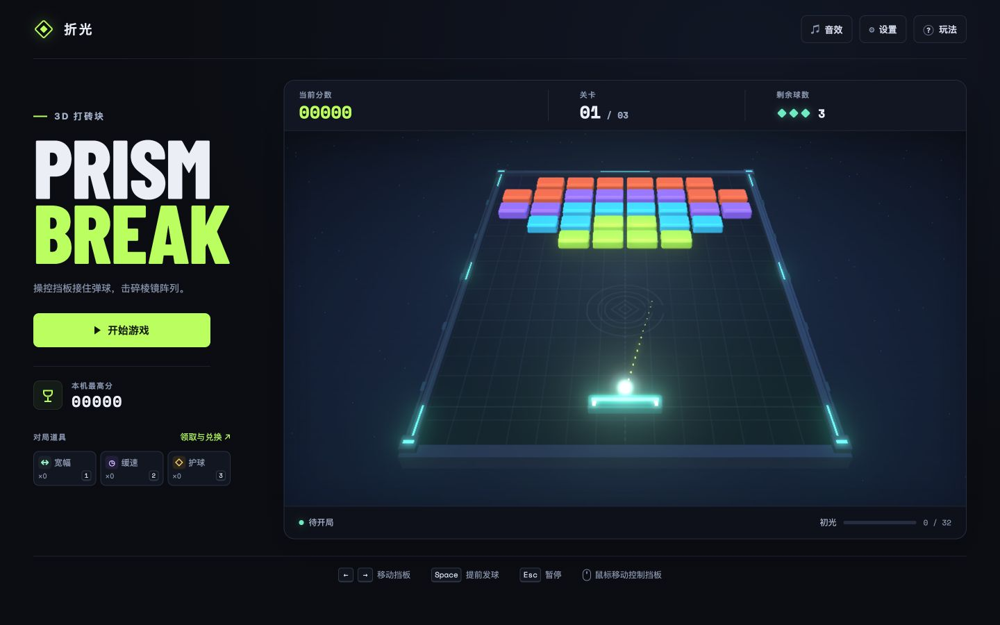

# 折光 · Prism Break

[在线试玩](https://remixjc.github.io/Play3D/) · [设计规范](docs/design-spec.md)

[](https://github.com/remixjc/Play3D/actions/workflows/pages.yml)

《折光》是一款原创的 3D 打砖块游戏。在霓虹球场接住弹球，利用挡板反弹角度清除砖阵，依次闯过「初光」「双螺旋」和「色散核心」。Three.js 负责透视渲染，球轨、碎片和音效均由程序生成。



## 快速上手

点「开始游戏」后倒数 3 秒，弹球自动发出。漏球后有新一轮倒计时。每局有三颗球，清光当前砖阵即可进入下一关。击中挡板边缘会改变反弹角度。一次回弹内连续碎砖时，分数会随连击增加。

| 操作 | 键盘与鼠标 | 触屏 |
| --- | --- | --- |
| 移动挡板 | ← / →，或在球场内移动鼠标 | 在球场内左右拖动 |
| 提前发球 | `Space` 或「立即发球」 | 点「立即发球」 |
| 暂停与继续 | `Esc` 或画面按钮 | 点画面按钮 |
| 使用道具 | 按 `1` / `2` / `3`，或点道具栏 | 点道具栏 |

倒计时期间可以移动挡板，也可以使用道具。暂停时倒计时和限时道具都会停住。

## 积分与道具

打开「设置」或道具栏里的「领取与兑换」。每天按设备本地日期可领取 120 积分，击碎每块砖另得 2 积分。积分与对局分数各自计算。兑换获得的道具存入库存，每次激活消耗一个。

| 道具 | 价格 | 效果 |
| --- | ---: | --- |
| 宽幅 | 45 | 挡板加宽 50%，持续 12 秒 |
| 缓速 | 55 | 弹球降速 35%，持续 10 秒 |
| 护球 | 80 | 自动救回一次漏接的球 |

积分、库存、最高分和音效偏好保存在当前浏览器，同一浏览器里不同站点的存档独立。游戏无须注册或连接后端。

## 本地开发

需要 Node.js 20.19.x 或 22.12 及以上版本，以及支持 WebGL 2 的浏览器。持续集成使用 Node.js 24。

```sh
git clone https://github.com/remixjc/Play3D.git
cd Play3D
npm ci
npm run dev
```

| 命令 | 作用 |
| --- | --- |
| `npm test` | 测试领取、兑换和道具碰撞逻辑 |
| `npm run build` | 生成静态文件到 `dist/` |
| `npm run preview` | 在本机预览构建结果 |

## 部署

本仓库使用 GitHub Actions 自动部署。推送到 `main` 后，工作流安装依赖、运行测试、构建并发布 `dist/`；也可以在 Actions 中手动运行工作流。Fork 后，从仓库 **Settings → Pages** 将发布来源设为 **GitHub Actions**。

自托管时，将 `dist/` 整个目录交给静态服务器即可。相对资源路径适用于根目录和子目录，构建后的脚本与字体都随站点部署。

## 源码结构

| 文件 | 职责 |
| --- | --- |
| [`src/game.js`](src/game.js) | 关卡、碰撞、计分与对局道具 |
| [`src/scene.js`](src/scene.js) | 3D 球场、灯光、球轨和碎砖特效 |
| [`src/economy.js`](src/economy.js) | 积分领取、兑换与本地库存 |
| [`src/main.js`](src/main.js) · [`src/item-panel.js`](src/item-panel.js) | 操作、倒计时、音效与设置界面 |
| [`.github/workflows/pages.yml`](.github/workflows/pages.yml) | 测试、构建与发布 |

Three.js、Barlow Condensed 和 Space Mono 的许可文本位于 [`public/licenses/`](public/licenses/)。
